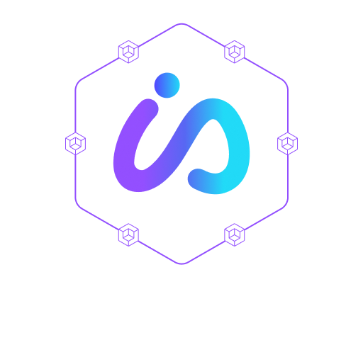

  

<h1 align="center">Engineering What's Next</h1>

  Custom software. Intelligent automation. Connected systems. 
  Engineering for the products and businesses of tomorrow.

  <a href="https://irussoft.com"><strong>Explore IRUSSOFT ↗</strong></a>

---

## Software built around your business

IRUSSOFT is a software engineering and technology company helping businesses build products, automate operations, and connect complex systems. Our capabilities span custom software, artificial intelligence, blockchain, enterprise platforms, and cloud infrastructure.

We work with organizations worldwide through project delivery, dedicated engineering teams, and offshore development.

## What we build

| Capability | Focus |
| :--- | :--- |
| **Custom Software Development** | Applications and platforms designed around business requirements. |
| **AI Agents & Intelligent Automation** | AI assistants, automated workflows, and integrations with business systems. |
| **Blockchain & Web3** | Smart contracts, decentralized applications, and blockchain integrations. |
| **Real-World Asset Tokenization** | Software for representing and managing real-world assets on blockchain networks. |
| **Enterprise Software & Integrations** | Business platforms, APIs, and connected enterprise workflows. |
| **Cloud Infrastructure & DevOps** | Cloud environments, delivery pipelines, and infrastructure automation. |
| **Software Security & Modernization** | Security improvements and the evolution of existing applications. |
| **Dedicated Engineering Teams** | Engineering capacity for ongoing product development and global delivery. |

## Our engineering priorities

- **Clarity before complexity.** Understand the problem, constraints, and intended outcome.
- **Maintainability from the start.** Favor clear architecture, readable code, and useful documentation.
- **Quality throughout delivery.** Treat security, accessibility, performance, and testing as engineering responsibilities.
- **Collaboration that works.** Keep communication direct and technical decisions understandable.

## Explore our work on GitHub

Browse the public repositories below for available projects and technical resources. Each repository's README explains its purpose, setup, and usage. Contribution guidance and licensing, where provided, are specific to that repository.

---

  <strong>Have a product to build or a system to improve?</strong> 
  Let's talk about the engineering behind it.

  <a href="https://irussoft.com"><strong>Start a conversation at irussoft.com ↗</strong></a>

  IRUSSOFT · Engineering What's Next

